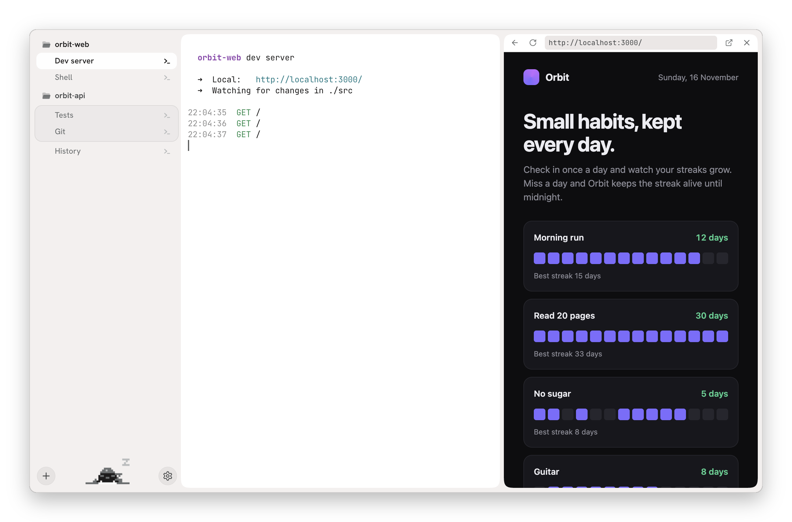
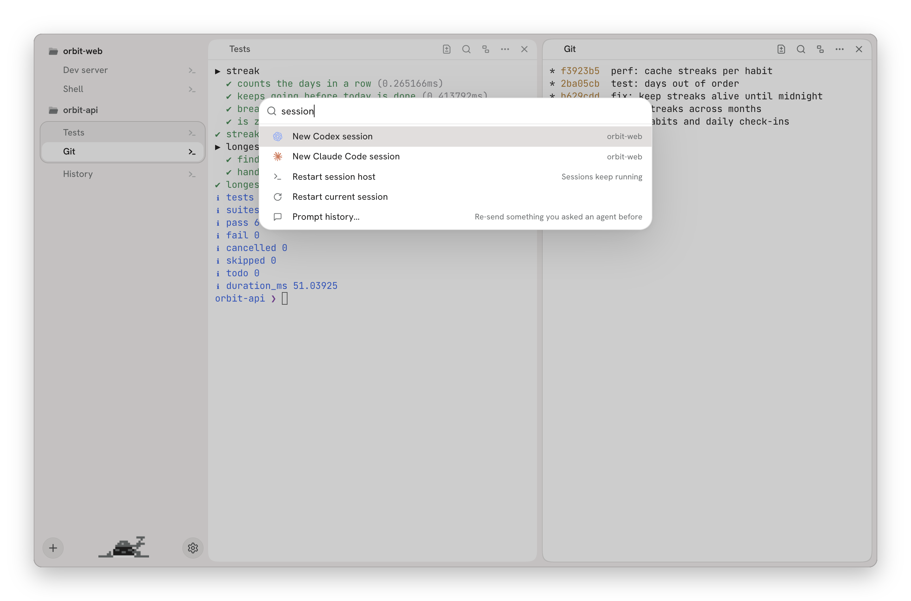
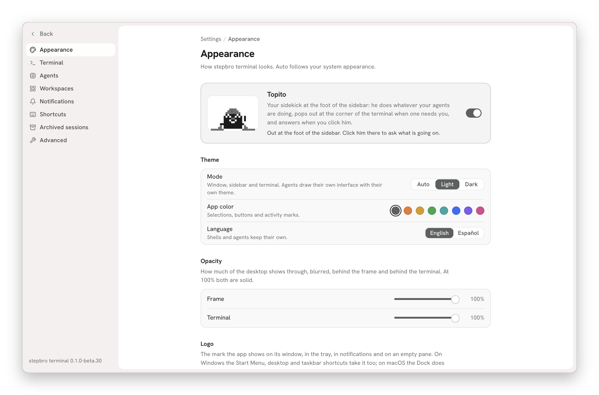

<p align="center">
  <picture>
    <source media="(prefers-color-scheme: dark)" srcset="resources/icons/dock-dark.png">
    
  </picture>
</p>

<h1 align="center">stepbro terminal</h1>

<p align="center">
  Una terminal para quienes trabajan con agentes de código todo el día. Windows, macOS y Linux.
</p>

<p align="center">
  <a href="https://github.com/stepbro-lab/StepbroTerminal/releases"></a>
  
  
  <a href="LICENSE.md"></a>
</p>

<p align="center">
  <a href="README.md">English</a> · <strong>Español</strong>
</p>

---

stepbro terminal es ante todo una terminal de verdad: cada sesión es tu propio shell (PowerShell,
bash, zsh) dentro de la carpeta de un proyecto. Escribe `claude`, `codex`, `gemini`, `npm run dev`
o lo que quieras. Encima de eso añade lo que le falta a una pestaña de terminal normal cuando
trabajan varios agentes a la vez: sabe qué hace cada uno, te avisa cuando uno te necesita, mantiene
vivas las sesiones aunque cierres la ventana y deja que los agentes trabajen entre ellos.

<p align="center">
  <picture>
    <source media="(prefers-color-scheme: dark)" srcset="docs/screenshots/hero-dark.png">
    
  </picture>
</p>

## Funciones

- **Sesiones que sobreviven a la ventana.** Cada shell corre en un pequeño proceso aparte de la app.
  Ciérrala, actualízala o recárgala, vuelve después, y la terminal sigue ahí con todo lo que mostró.
- **Una barra lateral que hace de panel.** Las carpetas a la izquierda, sus sesiones debajo, y el
  estado de cada una: trabajando, te necesita, terminó. Una campana arriba lista lo que te necesita.
- **Los agentes a un clic.** Pasa el puntero por el `+` de una carpeta y aparece un botón por cada
  agente que tengas instalado. La app los encuentra en tu `PATH`; ninguno es obligatorio.
- **El estado exacto de cada agente.** Claude Code avisa por sus propios hooks (trabajando, esperando
  permiso, terminó), y Codex, OpenCode y los demás se leen de su pantalla y su título. Las sesiones
  se ponen nombre según lo que pides.
- **Conversaciones que continúan.** Reinicia una sesión de Claude Code o Codex y retoma la misma
  conversación en vez de empezar una vacía.
- **Agentes que trabajan juntos.** Un servidor MCP integrado deja que los agentes de tus sesiones
  vean y lean las terminales de los demás, le pasen trabajo a otra sesión y le respondan, guarden
  notas compartidas, armen espacios de trabajo y usen un navegador junto a la terminal.
- **Paneles divididos y espacios de trabajo.** Divide cualquier terminal a la derecha o hacia abajo,
  mueve paneles entre vistas y guarda grupos de paneles que abres de una vez.
- **Un panel de vista previa.** La página que sirve tu servidor de desarrollo, al lado de la sesión
  que lo inició, para ti y para tus agentes.
- **Notificaciones y bandeja.** Te enteras cuando una sesión que no estás mirando te necesita o
  termina, con el sonido de la app al volumen que elijas.
- **Hecha para verse bien.** Temas claro y oscuro, ventana translúcida, Topito, el topo que actúa lo
  que hacen tus agentes, y la interfaz en inglés y español.
- **Primero el teclado.** Paleta de comandos, historial de prompts, búsqueda, y todos los atajos se
  pueden cambiar.

<p align="center">
  <picture>
    <source media="(prefers-color-scheme: dark)" srcset="docs/screenshots/palette-dark.png">
    
  </picture>
  <picture>
    <source media="(prefers-color-scheme: dark)" srcset="docs/screenshots/settings-dark.png">
    
  </picture>
</p>

### Agentes que reconoce

Claude Code, Codex, Gemini CLI, Cursor Agent, OpenCode, Kimi Code, Clyra, Deep Code, Codewhale, y
Claude Code con los modelos de DeepSeek usando tu propia clave de DeepSeek. Cualquier otro programa
corre como en cualquier terminal.

## Descarga

Los instaladores se publican en la
[página de versiones](https://github.com/stepbro-lab/StepbroTerminal/releases).

| Sistema | Archivo |
| --- | --- |
| Windows 10 y 11 | `StepbroTerminal-<versión>-win-x64.exe` |
| macOS, Apple silicon | `StepbroTerminal-<versión>-mac-arm64.dmg` |
| macOS, Intel | `StepbroTerminal-<versión>-mac-x64.dmg` |
| Linux | `.AppImage`, o `.deb` para Debian y Ubuntu |

Las versiones todavía no van firmadas con un certificado de pago, así que el sistema pregunta una
vez:

- **macOS:** si la app se bloquea la primera vez, abre **Ajustes del Sistema › Privacidad y
  seguridad** y pulsa **Abrir igualmente**.
- **Windows:** si SmartScreen dice "Windows protegió tu PC", pulsa **Más información › Ejecutar de
  todas formas**.

En Windows y con el AppImage la app se actualiza sola; en macOS y con el `.deb` te avisa cuando hay
una versión nueva y te lleva a ella.

## Atajos de teclado

`Mod` es <kbd>⌘</kbd> en macOS y <kbd>Ctrl</kbd> en Windows y Linux. Todos se pueden cambiar en
**Ajustes › Atajos**.

| Atajo | Acción |
| --- | --- |
| `Mod+K` | Paleta de comandos |
| `Mod+T` / `Mod+N` | Nuevo shell / nueva sesión |
| `Mod+1…9` | Ir a una sesión |
| `Mod+J` | Siguiente sesión que te necesita |
| `Mod+Shift+D` / `Mod+Shift+E` | Dividir a la derecha / hacia abajo |
| `Mod+F` | Buscar en la terminal |
| `Mod+Shift+H` | Historial de prompts |
| `Mod+Shift+N` | Notas |
| `Mod+B` | Mostrar u ocultar la barra lateral |
| `Mod+,` | Ajustes |

## Privacidad

- Todo se queda en tu computadora. No hay cuentas, ni analíticas, ni telemetría.
- La app solo se conecta a internet para buscar actualizaciones en
  [las versiones de este repositorio](https://github.com/stepbro-lab/StepbroTerminal/releases). Los
  agentes que uses hablan con sus propios servicios, como en cualquier terminal.
- Mientras Discord está abierto, tu perfil de Discord muestra que usas stepbro terminal y con qué
  agentes, nunca tus carpetas, sesiones ni lo que escribes. Solo habla con la app de Discord de tu
  equipo, y **Ajustes › Apariencia** lo apaga.
- El estado y los registros de las sesiones viven en `~/.step`; las preferencias, en la carpeta de
  datos de apps del sistema.
- stepbro terminal nunca edita `~/.claude/settings.json`: los hooks y su servidor MCP se le pasan a
  Claude Code en cada sesión, por la línea de comandos.
- El punto al que envían esos hooks y el servidor MCP solo escucha en `127.0.0.1`, protegido con un
  token aleatorio.

## Compilar desde el código

Necesitas [Node.js](https://nodejs.org) 22 (ver `.nvmrc`) y [pnpm](https://pnpm.io) 10.

```sh
git clone https://github.com/stepbro-lab/StepbroTerminal.git
cd StepbroTerminal
pnpm install
pnpm dev
```

| Comando | Qué hace |
| --- | --- |
| `pnpm dev` | Abre la app con recarga en caliente |
| `pnpm test` | Pruebas unitarias (Vitest) |
| `pnpm typecheck` | Revisa los tipos del proceso principal, el host y la ventana |
| `pnpm build` | Compila todo en `out/` |
| `pnpm dist:win`, `dist:mac`, `dist:linux` | Genera un instalador en `release/` |
| `pnpm icons` | Genera los iconos de la app y la bandeja a partir de los originales en `resources/icons` |

### Trabajar en ella junto a la app que usas

Una versión de desarrollo comparte `~/.step` con la app instalada, a menos que le des carpetas
propias. Hazlo, para que reiniciar en desarrollo nunca cierre las sesiones en las que estás
trabajando:

```sh
STEP_HOME=/tmp/step-dev/home STEP_USER_DATA=/tmp/step-dev/data pnpm dev
```

Las versiones de desarrollo abren un puerto de DevTools. `node scripts/cdp.mjs "<js>"` ejecuta
código en la ventana (usa `STEP_CDP_PORT` si no lo encuentra), `node scripts/mcp.mjs <sessionId>
<tool> [json]` llama a las herramientas MCP como lo haría un agente, y `node scripts/host-smoke.mjs`
abre un shell de prueba en un host en marcha, sin la interfaz.

### Cómo está armada

```
src/host      El host de sesiones: maneja las PTY (node-pty), el historial, los registros, el
              socket local y el punto de los hooks de Claude Code y el servidor MCP. Corre aparte,
              uno por usuario, y sobrevive a la app.
src/main      El proceso principal de Electron: habla con el host y maneja la ventana, la bandeja,
              las notificaciones, las preferencias, las actualizaciones, la detección de agentes y
              la lectura de su historial.
src/preload   El puente tipado entre el proceso principal y la ventana.
src/renderer  La interfaz en React. Las instancias de xterm.js viven fuera de React, y solo las
              terminales visibles usan un contexto WebGL.
src/shared    Tipos, el códec de mensajes, rutas y textos que usan todas las partes.
```

## Contribuir

Los reportes de errores, las ideas y los pull requests son bienvenidos. Lee
[CONTRIBUTING.md](CONTRIBUTING.md) antes de empezar, y usa
[Discussions](https://github.com/stepbro-lab/StepbroTerminal/discussions) para preguntas y
sugerencias. Todas las personas que participan siguen el [Código de conducta](CODE_OF_CONDUCT.md).

¿Encontraste un problema de seguridad? Repórtalo en privado, como explica
[SECURITY.md](SECURITY.md).

## Licencia

El código de stepbro terminal está abierto bajo la
[PolyForm Noncommercial License 1.0.0](LICENSE.md). Puedes usarlo, estudiarlo, cambiarlo y
compartirlo para cualquier fin no comercial, siempre que quien reciba una copia reciba también la
licencia y este aviso:

```
Required Notice: Copyright 2026 kevin9038440334 (https://github.com/kevin9038440334)
```

El uso comercial necesita una licencia aparte de los autores. La licencia cubre el código, no la
marca: el nombre stepbro, el logo, los iconos y Topito no se licencian para otros proyectos. Un fork
tiene que usar su propio nombre e icono, como explica [TRADEMARKS.md](TRADEMARKS.md).

<p align="center">
  Hecho por <a href="https://github.com/stepbro-lab">stepbro lab</a>
</p>
