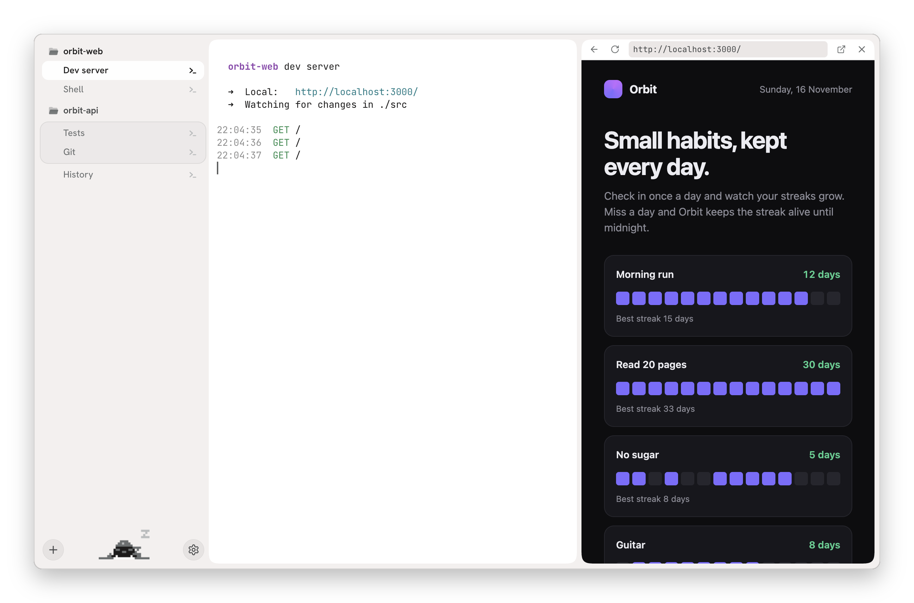
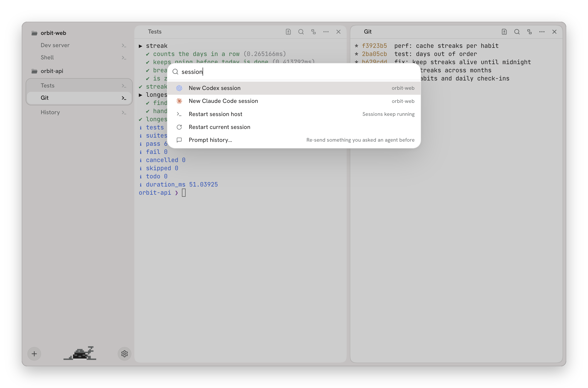
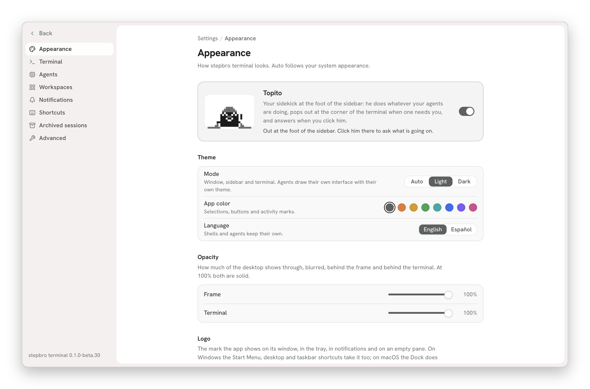

<p align="center">
  <picture>
    <source media="(prefers-color-scheme: dark)" srcset="resources/icons/dock-dark.png">
    
  </picture>
</p>

<h1 align="center">stepbro terminal</h1>

<p align="center">
  A terminal for people who run coding agents all day. Windows, macOS and Linux.
</p>

<p align="center">
  <a href="https://github.com/kevin9038440334/StepbroTerminal-releases/releases"></a>
  
  
  <a href="LICENSE.md"></a>
</p>

<p align="center">
  <strong>English</strong> · <a href="README.es.md">Español</a>
</p>

---

stepbro terminal is a real terminal first: every session is your own shell (PowerShell, bash, zsh)
running inside a project folder. Type `claude`, `codex`, `gemini`, `npm run dev` or anything else.
On top of that it adds what a plain terminal tab is missing when several agents work at once: it
knows what each one is doing, tells you when one needs you, keeps every session alive when the
window closes, and lets the agents work with each other.

<p align="center">
  <picture>
    <source media="(prefers-color-scheme: dark)" srcset="docs/screenshots/hero-dark.png">
    
  </picture>
</p>

## Features

- **Sessions that outlive the window.** Every shell runs in a small host process outside the app.
  Quit, update or reload it, come back later, and the terminal is still there with its output.
- **A sidebar that works as a dashboard.** Folders on the left, sessions under them, and a status
  for each one: working, needs you, finished. A bell at the top lists what needs you.
- **Agents a click away.** Point at a folder's `+` for a button per agent you have installed. The
  app finds them on your `PATH`; none is required.
- **Precise agent state.** Claude Code reports through its own hooks (working, waiting for
  permission, finished), and Codex, OpenCode and the rest are read from their screens and titles.
  Sessions name themselves after what you ask.
- **Conversations that resume.** Restart a Claude Code or Codex session and it picks up the same
  conversation instead of starting an empty one.
- **Agents that work together.** A built-in MCP server lets the agents in your sessions list and
  read each other's terminals, hand work to another session and report back, keep shared notes,
  set up workspaces, and drive a browser preview beside the terminal.
- **Split panes and workspaces.** Split any terminal right or down, move panes between views, and
  save sets of panes you open in one go.
- **A preview pane.** The page your dev server serves, next to the session that started it, for
  you and for your agents.
- **Notifications and tray.** You hear about a session you are not looking at when it needs input
  or finishes, with the app's own sound at the volume you choose.
- **Made to be looked at.** Light and dark themes, a translucent window, Topito the mole who acts
  out what your agents are doing, and the interface in English and Spanish.
- **Keyboard first.** A command palette, prompt history, search, and every shortcut can be changed.

<p align="center">
  <picture>
    <source media="(prefers-color-scheme: dark)" srcset="docs/screenshots/palette-dark.png">
    
  </picture>
  <picture>
    <source media="(prefers-color-scheme: dark)" srcset="docs/screenshots/settings-dark.png">
    
  </picture>
</p>

### Agents it knows

Claude Code, Codex, Gemini CLI, Cursor Agent, OpenCode, Kimi Code, Clyra, Deep Code, Codewhale,
and Claude Code on DeepSeek's models with your own DeepSeek key. Anything else runs as it would in
any terminal.

## Download

Installers are published on the
[releases page](https://github.com/kevin9038440334/StepbroTerminal-releases/releases).

| System | File |
| --- | --- |
| Windows 10 and 11 | `StepbroTerminal-<version>-win-x64.exe` |
| macOS, Apple silicon | `StepbroTerminal-<version>-mac-arm64.dmg` |
| macOS, Intel | `StepbroTerminal-<version>-mac-x64.dmg` |
| Linux | `.AppImage`, or `.deb` for Debian and Ubuntu |

The builds are not signed with a paid certificate yet, so the system asks once:

- **macOS:** if the app is blocked on first launch, open **System Settings › Privacy & Security**
  and click **Open Anyway**.
- **Windows:** if SmartScreen shows "Windows protected your PC", click **More info › Run anyway**.

On Windows and with the AppImage the app updates itself; on macOS and with the `.deb` it tells you
when a new version is out and links to it.

## Keyboard shortcuts

`Mod` is <kbd>⌘</kbd> on macOS and <kbd>Ctrl</kbd> on Windows and Linux. All of them can be changed
in **Settings › Shortcuts**.

| Shortcut | Action |
| --- | --- |
| `Mod+K` | Command palette |
| `Mod+T` / `Mod+N` | New shell / new session |
| `Mod+1…9` | Jump to a session |
| `Mod+J` | Next session that needs you |
| `Mod+Shift+D` / `Mod+Shift+E` | Split right / split down |
| `Mod+F` | Find in the terminal |
| `Mod+Shift+H` | Prompt history |
| `Mod+Shift+N` | Notes |
| `Mod+B` | Toggle the sidebar |
| `Mod+,` | Settings |

## Privacy

- Everything stays on your computer. There are no accounts, no analytics and no telemetry.
- The app itself only goes online to check
  [the releases repository](https://github.com/kevin9038440334/StepbroTerminal-releases) for
  updates. The agents you run talk to their own services, as they would in any terminal.
- While Discord is open, your Discord profile shows that you are using stepbro terminal and which
  agents, never your folders, sessions or what you type. It talks to the local Discord app only, and
  **Settings › Appearance** turns it off.
- Session state and logs live in `~/.step`; preferences live in the system's app data folder.
- stepbro terminal never edits `~/.claude/settings.json`: hooks and its MCP server are passed to
  Claude Code per session, on the command line.
- The endpoint those hooks and the MCP server post to listens on `127.0.0.1` only, behind a random
  token.

## Building from source

You need [Node.js](https://nodejs.org) 22 (see `.nvmrc`) and [pnpm](https://pnpm.io) 10.

```sh
git clone https://github.com/stepbro-lab/StepbroTerminal.git
cd StepbroTerminal
pnpm install
pnpm dev
```

| Command | What it does |
| --- | --- |
| `pnpm dev` | Runs the app with hot reload |
| `pnpm test` | Unit tests (Vitest) |
| `pnpm typecheck` | Type checks the main process, the host and the window |
| `pnpm build` | Compiles everything into `out/` |
| `pnpm dist:win`, `dist:mac`, `dist:linux` | Builds an installer into `release/` |
| `pnpm icons` | Renders the app and tray icons from the masters in `resources/icons` |

### Working on it next to the app you use

A development build shares `~/.step` with an installed copy unless you give it folders of its own.
Do that, so a restart in development never closes the sessions you are working in:

```sh
STEP_HOME=/tmp/step-dev/home STEP_USER_DATA=/tmp/step-dev/data pnpm dev
```

Development builds open a DevTools port. `node scripts/cdp.mjs "<js>"` evaluates code in the window
(set `STEP_CDP_PORT` if it cannot find it), `node scripts/mcp.mjs <sessionId> <tool> [json]` calls
the MCP tools the way an agent would, and `node scripts/host-smoke.mjs` opens a throwaway shell on a
running host without the UI.

### How it is put together

```
src/host      The session host: owns the PTYs (node-pty), scrollback, session logs, the local
              socket, and the endpoint for Claude Code hooks and the MCP server. Runs detached,
              one per user, and survives the app.
src/main      Electron's main process: talks to the host, owns the window, tray, notifications,
              preferences, updates, agent detection and the readers for agents' history.
src/preload   The typed bridge between the main process and the window.
src/renderer  The React interface. xterm.js instances live outside React, and only the visible
              terminals hold a WebGL context.
src/shared    Types, the frame codec, paths and strings used by all of them.
```

How the host was made fast, with numbers you can reproduce, is in
[BACKEND_PERFORMANCE.md](BACKEND_PERFORMANCE.md).

## Contributing

Bug reports, ideas and pull requests are welcome. Read [CONTRIBUTING.md](CONTRIBUTING.md) before
you start, and use [Discussions](https://github.com/stepbro-lab/StepbroTerminal/discussions) for
questions and suggestions. Everyone taking part follows the
[Code of Conduct](CODE_OF_CONDUCT.md).

Found a security problem? Please report it privately, as described in [SECURITY.md](SECURITY.md).

## License

stepbro terminal is source-available under the
[PolyForm Noncommercial License 1.0.0](LICENSE.md). You may use, study, change and share it for any
noncommercial purpose, as long as everyone who gets a copy also gets the license and this notice:

```
Required Notice: Copyright 2026 kevin9038440334 (https://github.com/kevin9038440334)
```

Commercial use needs a separate license from the authors. The license covers the code, not the
brand: the stepbro name, logo, icons and Topito are not licensed for use by other projects. A fork
has to go by its own name and icon, as [TRADEMARKS.md](TRADEMARKS.md) explains.

<p align="center">
  Made by <a href="https://github.com/stepbro-lab">stepbro lab</a>
</p>
